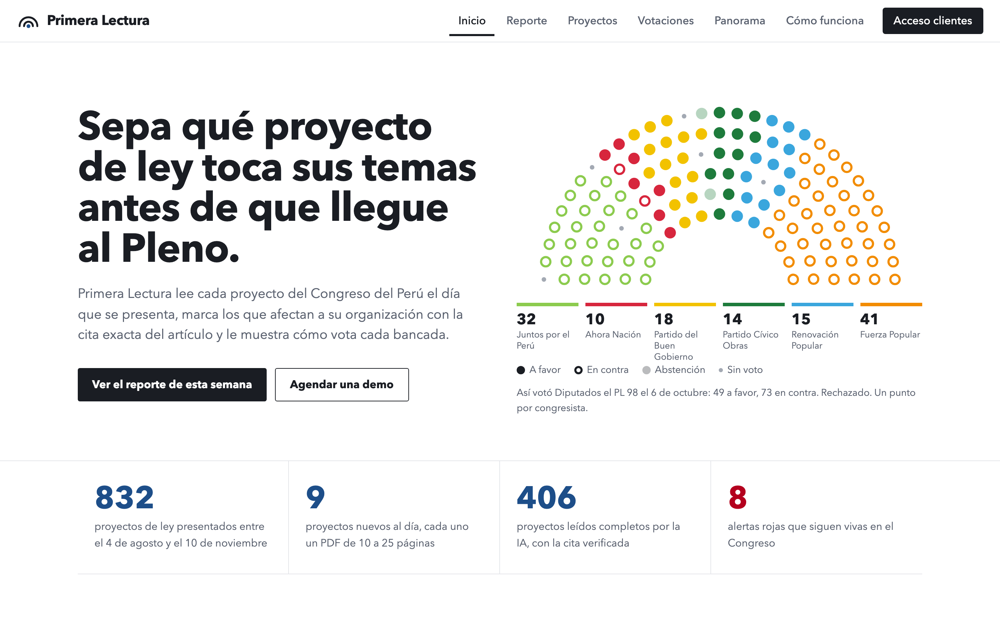
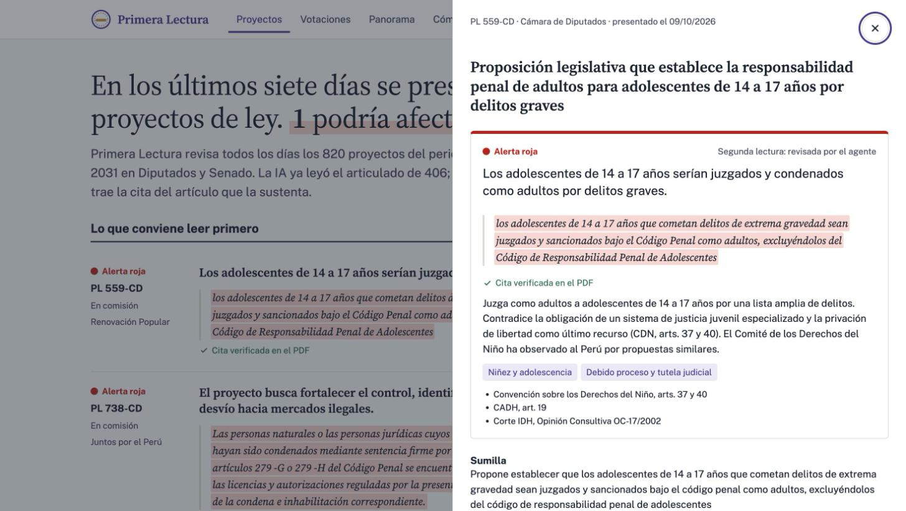
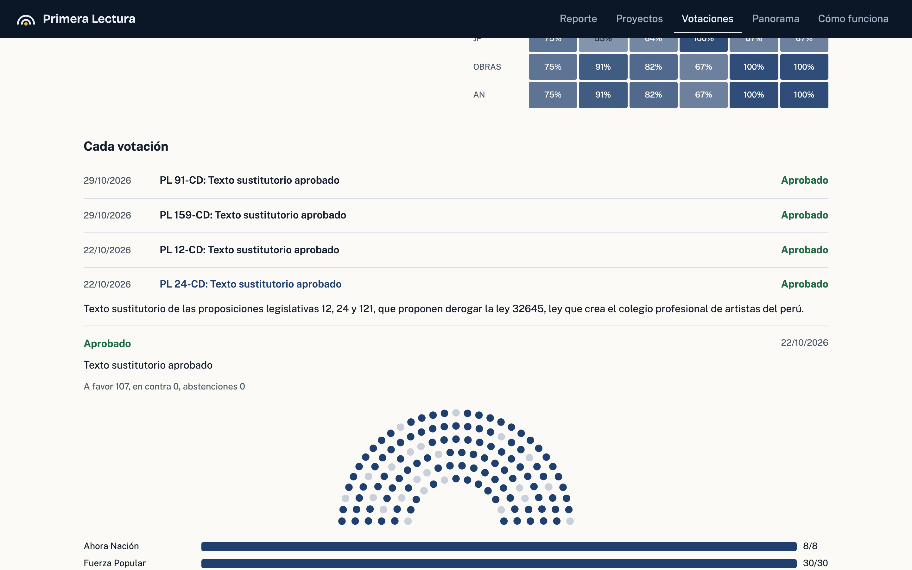
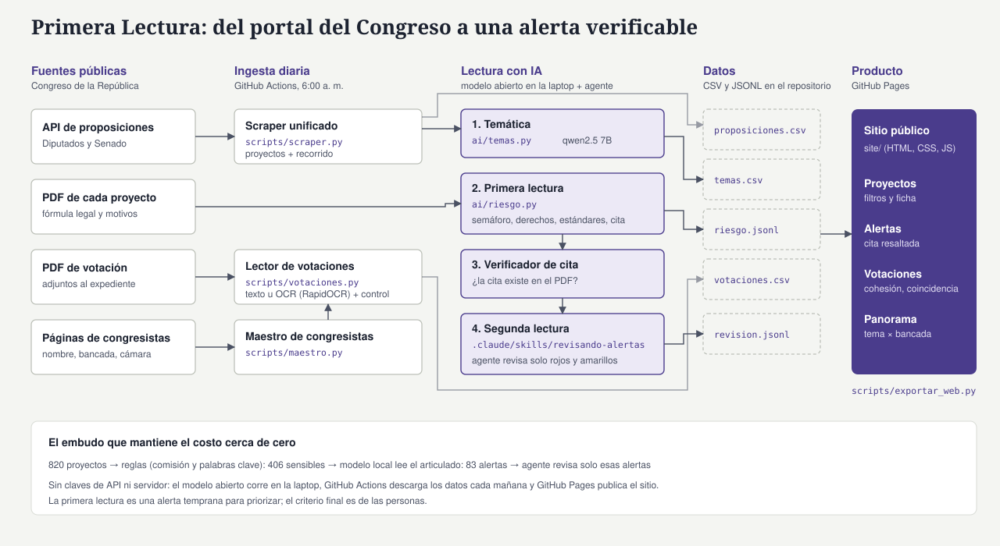
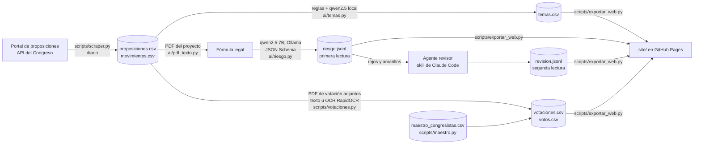

# Primera Lectura

> **Primera Lectura sigue todo lo que pasa en el Congreso del Perú, desde que se presenta un proyecto de ley hasta
> cómo vota cada bancada, y alerta a cada cliente sobre lo que toca sus temas, citando el artículo exacto.**

**Demo:** https://ximenapize.github.io/primera-lectura/ · **Video de respaldo:** [[link al video]]



---

## 1. Founder

**Ximena Alejandra Pinillos Zegarra** · [[foto: docs/founder.jpg]]

Trabajo en **EntreLíneas**, un observatorio de proyectos de ley, y en un observatorio que hace seguimiento al
Congreso, al Ejecutivo, a las políticas públicas y a la participación social. Vivo el problema desde adentro: en el
seguimiento legislativo cada flujo se hace por separado, nadie integra la ruta completa de un proyecto de ley y no
hay un criterio claro para clasificarlo como riesgoso sin recurrir a la literatura, a los instrumentos de derechos
humanos o a la opinión de abogados y politólogos. Construí los scrapers del portal de proposiciones y de las
votaciones del Pleno que son la base de este producto.

Cubro producto, ingeniería, diseño y ventas con agentes de IA: Claude Code fue mi co-founder técnico (ver la
sección 9), un modelo abierto (qwen2.5) hace la lectura de cada proyecto y un agente revisor hace la segunda
lectura de las alertas.

## 2. Problema

**Quién lo sufre:** los equipos que hacen seguimiento legislativo: consultoras de asuntos públicos, gremios
empresariales, observatorios y ONG de la sociedad civil, y centros académicos.

**Cuánto les cuesta:** el Congreso bicameral presentó **820 proyectos de ley entre el 4 de agosto y el 9 de
noviembre de 2026** (casi 9 por día hábil y calendario). Cada proyecto es un PDF de 10 a 25 páginas. Seguir uno
significa volver al portal una y otra vez: pasa a comisión, sale el dictamen, entra a la agenda, se vota en el
Pleno. Las votaciones nominales salen en PDF escaneados.

**Cómo lo resuelven hoy:** el portal del Congreso, Excel y WhatsApp, con tres problemas de fondo:
1. **Flujos separados:** quien registra los proyectos nuevos, quien sigue las comisiones y quien mira las
   votaciones trabajan por su lado. **Nadie integra la ruta completa** de un proyecto de ley.
2. **Sin criterio de riesgo explícito:** decidir si un proyecto es riesgoso depende de quién lo lea y de que haya
   tiempo para consultar la literatura, los instrumentos de derechos humanos o a un abogado o politólogo.
3. **No escala:** casi nueve proyectos al día, cada uno un PDF largo.

En las conversaciones con usuarios encontramos:
- Equipos que se turnan un día a la semana para revisar el portal **leyendo solo los títulos**, y que se pasan el
  PDF por WhatsApp para que todos lo lean antes de decidir si merece alerta.
- Herramientas internas que usan IA **solo sobre la sumilla**, por el costo de procesar el PDF completo. Lo que
  está en el articulado y no en la sumilla se puede pasar.
- Seguimiento posterior que se abandona: el estado se registra cuando el proyecto entra y nadie lo vuelve a
  revisar.
- Análisis de riesgo hecho **uno por uno** por una persona de ciencias sociales y una de derecho, lo que limita la
  velocidad.

> *"Era dolorosamente notoria la falta de automatización."* (analista de seguimiento legislativo)

**Evidencia:** notas de las conversaciones con usuarios en [`docs/research/`](docs/research/)
(anonimizadas): [conversación 1](docs/research/conversacion_1.md) con el responsable de tecnología de un
observatorio legislativo y [conversación 2](docs/research/conversacion_2.md) con un analista que hizo seguimiento
en un observatorio peruano y en un centro académico que monitorea seis congresos de Latinoamérica.

## 3. Solución e insight

Primera Lectura hace el **seguimiento completo** del Congreso, todos los días y sin intervención:

1. **Descarga** cada proyecto de ley de Diputados y Senado, con su recorrido y los PDF de votación adjuntos.
2. **Clasifica** cada proyecto por temática y bancada, y muestra en qué etapa va.
3. **Lee el articulado** (la fórmula legal del PDF, no la sumilla) y pone un **semáforo** con los derechos y
   estándares en juego y **la cita textual que lo sustenta**. Python verifica que la cita exista en el PDF.
4. **Segunda lectura:** un agente revisor relee solo las alertas rojas y amarillas y corrige la dirección del
   efecto o los estándares citados.
5. **Votaciones:** lee las votaciones nominales del Pleno (texto u OCR), las contrasta con los totales impresos y
   muestra cómo votó cada bancada, su cohesión y quién vota con quién.

**El insight:** lo que importa de un proyecto de ley está en su articulado, pero leer 800 PDF con una API de pago
es caro, y por eso hoy la IA se aplica solo a la sumilla. **Un modelo abierto de 7B corriendo en una laptop lee el
articulado completo a costo marginal casi cero**, y un embudo de reglas → modelo local → agente revisor deja el
trabajo caro (el juicio fino) solo para el ~20 % de proyectos que alertan.

**Adaptable a cada cliente:** la lectura de la IA tiene un *lente*. Hoy es "derechos humanos y gobernanza"; el
mismo pipeline lee con otros lentes cambiando el prompt y el prefiltro:

| Cliente | Lente de la lectura |
|---|---|
| Observatorio u ONG | Derechos humanos y estándares internacionales (el demo) |
| Consultora minero-energética | Riesgo regulatorio: obligaciones, tributos, permisos, consulta previa |
| Gremio de salud | Regulación sanitaria, compras públicas, ejercicio profesional |
| Centro académico | Su eje de investigación (libertad de expresión, IA, ambiente…) |

## 4. Why now

- **Modelos abiertos pequeños con salidas estructuradas** (qwen2.5 7B en Ollama) corren en una laptop y devuelven
  JSON válido: hace tres años esto exigía una API cara o no era confiable.
- **El Congreso volvió a ser bicameral en 2026:** dos cámaras, dos numeraciones y el doble de fuentes que vigilar.
- **El OCR abierto** (RapidOCR) ya lee con precisión los PDF escaneados de las votaciones del Pleno.
- **Los agentes de código** permiten que una sola persona construya y mantenga el pipeline completo.

## 5. Demo

**URL pública:** https://ximenapize.github.io/primera-lectura/ (se actualiza sola todos los días).

| | |
|---|---|
|  |  |
| **Portada:** el titular se arma con los datos del día y las alertas rojas muestran la cita resaltada | **Ficha:** primera lectura, cita verificada, estándares, recorrido y votaciones por bancada |
|  | |
| **Votaciones:** cohesión de cada bancada y matriz de quién vota con quién | |

### Arquitectura



<details>
<summary>El mismo flujo en Mermaid (detalle de archivos)</summary>



</details>

**Modelos y por qué:**
- **qwen2.5 7B en Ollama, en la laptop**, para clasificar y leer el articulado: es gratis, no tiene límite de uso y
  respeta un JSON Schema. Un modelo de pago para 800 PDF largos no tiene sentido económico para el cliente.
- **Claude Code como agente revisor** solo sobre rojos y amarillos: el juicio jurídico fino se hace donde importa.
- **RapidOCR (ONNX)** para las votaciones escaneadas: corre en CPU, también en GitHub Actions.
- **Sin servidor:** GitHub Actions corre el scraper cada mañana y GitHub Pages publica el sitio estático.

### Cómo correrlo

```bash
git clone https://github.com/ximenapize/primera-lectura.git && cd primera-lectura
uv sync

uv run scripts/scraper.py        # proyectos de ley de ambas cámaras (~7 min)
uv run scripts/maestro.py        # base de congresistas
uv run scripts/votaciones.py     # votaciones adjuntas a los expedientes (texto u OCR)

# IA local: requiere Ollama con el modelo  ->  ollama pull qwen2.5:7b
uv run ai/temas.py               # temática de cada proyecto
uv run ai/riesgo.py --prefiltro  # primera lectura de los proyectos sensibles

uv run scripts/exportar_web.py   # JSON para el sitio
cd site && python3 -m http.server 8765   # abrir http://localhost:8765
```

Segunda lectura con el agente: abrir Claude Code en el repo y pedir *"revisa las alertas"* (skill
[`revisando-alertas`](.claude/skills/revisando-alertas/SKILL.md)).

No se necesitan claves de API: [`.env.example`](.env.example) queda vacío a propósito.

## 6. Modelo de negocio

Paga quien necesita anticiparse al Congreso. [[confirmar precios]]

| Plan | Para quién | Qué incluye | Precio |
|---|---|---|---|
| **Abierto** | Ciudadanía, ONG pequeñas, prensa | El sitio público con el lente de derechos humanos | Gratis |
| **Equipo** | Consultoras pequeñas, gremios, observatorios | Un lente propio (sus temas), alertas por correo, exportación a Excel | S/ 290 al mes |
| **Institucional** | Consultoras grandes, estudios de abogados, empresas reguladas | Varios lentes, seguimiento de proyectos específicos, reporte semanal | S/ 990 al mes |

**Costo por cliente (margen de contribución):**
- Modelo local: S/ 0 por token. Electricidad de la laptop: menos de S/ 5 al mes.
- GitHub Actions y Pages: S/ 0 en un repositorio público.
- Agente revisor: minutos de un plan de Claude Code que ya existe (unos US$ 20 al mes repartidos entre clientes).
- Configurar un lente nuevo: unas horas de trabajo una sola vez.

Con el plan Equipo, el margen de contribución supera el 90 %.

**Qué sigue:**
1. Selector "Mis temas" en el sitio y alertas por correo.
2. **Alertas de agenda:** avisar cuando un proyecto seguido entra a la agenda de una comisión o del Pleno.
3. OCR para los PDF de proyectos escaneados (hoy quedan fuera de la primera lectura).
4. Otros congresos de la región: los centros académicos ya monitorean varios países a mano.

## 7. Herramientas del curso

| Herramienta | Sesión | Para qué en el producto | Dónde |
|---|---|---|---|
| **Scraping y APIs** | 03 | API del portal de proposiciones (con el cifrado AES de sus URL), páginas de congresistas y PDF de votación | [`scripts/scraper.py`](scripts/scraper.py), [`scripts/maestro.py`](scripts/maestro.py), [`scripts/votaciones.py`](scripts/votaciones.py) |
| **LLMs con salidas estructuradas** | 08 | Temática y primera lectura con JSON Schema en un modelo abierto | [`ai/llm.py`](ai/llm.py), [`ai/temas.py`](ai/temas.py), [`ai/riesgo.py`](ai/riesgo.py) |
| **Document AI** | 10 | Extraer la fórmula legal de los PDF y leer las votaciones escaneadas con OCR por coordenadas | [`ai/pdf_texto.py`](ai/pdf_texto.py), [`scripts/votaciones.py`](scripts/votaciones.py) |
| **Skills de Claude Code** | 16 | Agente revisor que hace la segunda lectura de las alertas | [`.claude/skills/revisando-alertas/`](.claude/skills/revisando-alertas/SKILL.md), [`ai/revision.py`](ai/revision.py) |
| **Dashboards y despliegue** | 05, 12 | Sitio estático con filtros, fichas y gráficos; scraper diario y publicación automática | [`site/`](site/), [`.github/workflows/`](.github/workflows/) |

**Por qué estas:** el problema es leer PDF del Estado a escala. Scraping trae los documentos, Document AI los
vuelve texto, el LLM los lee con una estructura fija y la skill pone el criterio experto donde el modelo pequeño
falla. Además, **Whisper (sesión 13)** se usó en la investigación para transcribir en local las conversaciones
con usuarios, sin subir los audios a ningún servicio.

## 8. Qué tan bien funciona

- **Proyectos:** 820 (798 de Diputados y 22 del Senado) con 1,735 movimientos, actualizados a diario.
- **Primera lectura:** 406 proyectos sensibles leídos por el modelo local (13 rojos, 70 amarillos, 323 verdes), a
  unos 30 segundos por PDF.
- **Citas:** el 57 % de las citas del modelo local se verifican en el PDF. Las demás se marcan, y esa es la razón
  de la segunda lectura.
- **Segunda lectura:** en las primeras alertas revisadas, el agente corrigió 3 de 4. El modelo pequeño lee mal la
  dirección de las derogaciones: derogar una ley que *restringía* derechos lo marcaba como rojo.
- **Votaciones:** 22 votaciones nominales de 16 proyectos. En Diputados todas cuadran con los totales impresos;
  en el Senado (PDF escaneados) el OCR lee entre 54 y 59 de 60 votos por página, y los gráficos por bancada usan el
  cuadro oficial impreso.

## 9. Qué hizo el agente

Este repositorio se construyó con **Claude Code** como co-founder técnico. La división fue:

**Ximena (founder):** eligió el problema y el cliente, hizo las conversaciones con usuarios, escribió los scripts
originales de scraping de proposiciones y de extracción de votaciones (que el agente integró y reescribió),
definió los ejes de la lectura de riesgo, revisó los resultados y tomó las decisiones de producto y diseño.

**Claude Code:**
- Unificó los scrapers de Diputados y Senado en [`scripts/scraper.py`](scripts/scraper.py) y armó los Actions.
- Reescribió el pipeline de votaciones en un solo programa ([`scripts/votaciones.py`](scripts/votaciones.py)) a
  partir de los scripts de Ximena, con OCR por coordenadas, control contra totales impresos y votos orales.
- Escribió el cliente de Ollama, la clasificación, la lectura de riesgo y el verificador de citas (`ai/`).
- Creó la skill del agente revisor e hizo las primeras revisiones de alertas.
- Diseñó y programó el sitio estático (`site/`) y el exportador de datos.
- Transcribió las entrevistas con Whisper en local y redactó las notas anonimizadas para que Ximena las revisara.
- Redactó este README a partir de las decisiones de Ximena.

Todo el código fue revisado por Ximena, que puede explicarlo y modificarlo.

---

**Datos:** portal de proposiciones legislativas y PDF de votación del Congreso de la República del Perú
(información pública). No se usan datos personales más allá de los nombres de congresistas en ejercicio de su
función pública. **Licencia:** MIT.

*La primera lectura es una alerta temprana para priorizar el trabajo, no una opinión legal.*
